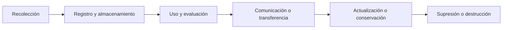
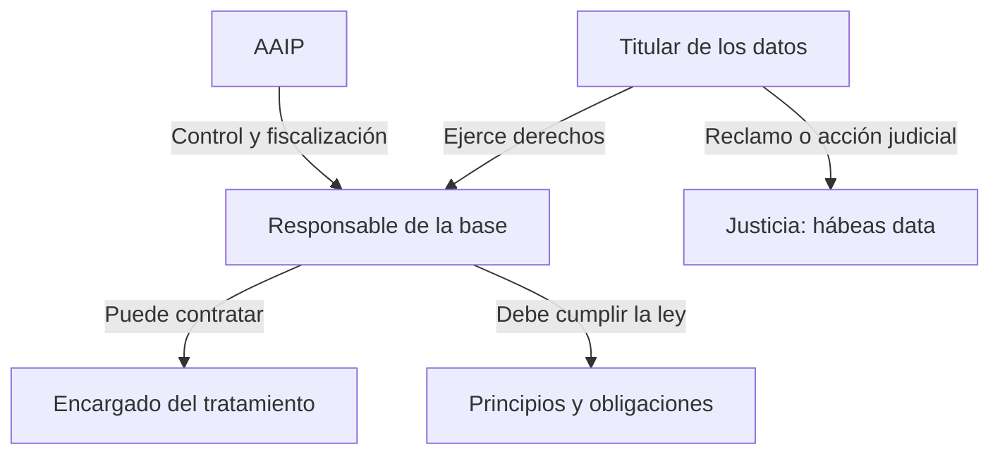

# Protección de datos personales y hábeas data

## Marco jurídico argentino, derechos y desafíos tecnológicos

Constitución Nacional · Ley 25.326 · Jurisprudencia

---

# ¿Por qué importa proteger los datos?

### Nuestra huella digital

- Navegación y búsquedas
- Compras y operaciones financieras
- Ubicación y dispositivos
- Fotografías y biometría
- Actividad en plataformas

### El riesgo

Cuando los datos se combinan, pueden construir perfiles detallados y afectar:

- La intimidad y el honor
- El acceso al crédito o al empleo
- La identidad y la dignidad
- La posibilidad de no ser discriminado

**Idea central:** no alcanza con que los datos se almacenen; importa quién los usa, para qué y bajo qué garantías.

---

# Marco constitucional y normativo

### Constitución Nacional

**Artículo 43, tercer párrafo**

Permite conocer los datos personales registrados y exigir, cuando corresponda, su supresión, rectificación, confidencialidad o actualización.

### Ley 25.326

**Protección de los Datos Personales**

Regula el tratamiento de datos, los derechos de sus titulares, las obligaciones de responsables y usuarios, y la acción de hábeas data.

- **Decreto 1558/2001:** reglamenta la ley.
- **AAIP:** autoridad de control del régimen nacional.
- **Artículo 43:** también protege el secreto de las fuentes de información periodística.

<small class="opacity-60">La reforma constitucional de 1994 dio reconocimiento constitucional expreso a esta garantía.</small>

---

# Protección de datos y autodeterminación informativa

La protección de datos reúne principios, derechos y obligaciones para que la información personal se recolecte y utilice de forma **legítima, adecuada, segura y compatible con su finalidad**.

### Conocer

Saber qué información existe y quién la posee.

### Controlar

Poder corregir, actualizar o suprimir datos cuando corresponda.

### Limitar

Evitar usos incompatibles, inseguros o discriminatorios.

<small class="opacity-70">La autodeterminación informativa se vincula con la facultad de decidir cuándo y dentro de qué límites se revela información propia.</small>

---

# ¿Qué se considera dato personal?

## Ley 25.326, artículo 2

> Información de cualquier tipo referida a personas físicas o de existencia ideal determinadas o determinables.

### Identificación directa

- Nombre y apellido
- DNI o CUIL
- Domicilio y correo
- Razón social o CUIT

### Identificación indirecta

- Dirección IP
- Número de legajo
- Identificador del dispositivo
- Patrón de geolocalización

Un dato puede ser personal aunque no identifique por sí solo: basta con que pueda vincularse razonablemente con una persona.

---

# Datos sensibles: mayor riesgo, mayor cuidado

La Ley 25.326 incluye datos que revelan:

- Origen racial o étnico
- Opiniones políticas
- Convicciones religiosas, filosóficas o morales
- Afiliación sindical
- Salud o vida sexual

### Riesgos

- Discriminación
- Estigmatización
- Exclusión
- Represalias

### Regla de protección

Nadie puede ser obligado a proporcionar datos sensibles. Su tratamiento está sujeto a restricciones y excepciones legales específicas.

<small class="opacity-70">El material también destaca reglas especiales para datos de salud y antecedentes penales.</small>

---

# El ciclo de vida del dato

Cada etapa puede constituir **tratamiento de datos personales**.

### Ejemplo: solicitud de un préstamo

1. Se completan datos en un formulario.
2. La entidad los almacena y evalúa el riesgo crediticio.
3. Puede comunicar información a terceros cuando exista una base legal.
4. Debe actualizarla y conservarla solo durante el plazo que corresponda.

---

# Principios que orientan el tratamiento

**Licitud y finalidad**

Tratar datos conforme a la ley y para fines compatibles con los informados.

**Calidad**

Datos ciertos, adecuados, pertinentes, exactos y actualizados.

**Información y transparencia**

Explicar qué se recoge, para qué, quién responde y qué derechos existen.

**Seguridad y confidencialidad**

Prevenir accesos no autorizados, alteraciones y filtraciones.

**Consentimiento**

Como regla general, libre, expreso e informado; existen excepciones legales.

**Cesión y transferencias**

Sujetos a condiciones, responsabilidades y límites legales.

**Consentir no significa autorizar cualquier uso posterior.**

---

# ¿Quiénes intervienen?

- **Responsable:** decide la finalidad y los medios del tratamiento.
- **Usuario:** realiza operaciones de tratamiento sobre los datos.
- **Encargado:** procesa datos por cuenta del responsable y no debe utilizarlos para fines ajenos al servicio.
- **AAIP:** ejerce funciones de control del régimen nacional.

Delegar el procesamiento en un tercero no elimina las obligaciones del responsable frente al titular.

---

# Derechos del titular: plazos clave

| Derecho | ¿Qué permite? | Plazo señalado en el material |
|---|---|---|
| Información | Conocer bases, responsables y finalidades | — |
| Acceso | Saber qué datos se registran sobre uno | **10 días** |
| Rectificación, actualización o supresión | Corregir, poner al día o eliminar cuando corresponda | **5 días hábiles** |

### Sin cargo

El ejercicio de rectificación, actualización y supresión debe realizarse gratuitamente.

### Si no hay respuesta adecuada

Puede acudirse a la autoridad de control y, cuando corresponda, a la vía judicial.

<small class="opacity-60">Plazos expuestos según el material proporcionado; la aplicación concreta depende del supuesto legal.</small>

---

# Hábeas data: conocer y controlar

El hábeas data es una **garantía constitucional** que permite conocer la información personal registrada y, cuando corresponda, exigir su corrección o protección.

### Dimensión informativa

- Qué datos existen
- Dónde están registrados
- Para qué se utilizan
- Quién los produjo o proporcionó, cuando sea jurídicamente posible

### Dimensión de control

- Rectificar datos incorrectos
- Actualizar datos desactualizados
- Suprimir datos cuando corresponda
- Preservar la confidencialidad

---

# Modalidades doctrinarias del hábeas data

**Informativo**

Conocer qué información posee una base y su finalidad.

**Rectificador**

Corregir información incorrecta.

**Actualizador**

Incorporar información nueva o poner al día la existente.

**Supresor**

Eliminar información cuando su conservación o tratamiento sea ilegítimo.

**Confidencial**

Evitar la divulgación ilegítima de información.

<small class="opacity-70">La clasificación es doctrinaria: las categorías no aparecen necesariamente con esta denominación exacta en la Ley 25.326. Pueden combinarse.</small>

---

# Procedimiento y límites

### Camino general

1. Identificar la base de datos y, si es posible, a su responsable.
2. Ejercer primero los derechos ante el responsable.
3. Si no hay respuesta adecuada, evaluar la vía ante la AAIP y/o judicial.
4. El juez puede ordenar rectificación, actualización, supresión o confidencialidad.

### Límites y garantías

- Puede haber excepciones fundadas por defensa, seguridad, orden público o derechos de terceros.
- El juez puede requerir información y documentación relevante.
- En determinadas circunstancias puede ordenarse el bloqueo provisional.
- Debe armonizarse la protección de datos con otros derechos e intereses legítimos.

El hábeas data no reemplaza los derechos del titular: ofrece una garantía para hacerlos efectivos cuando no se respetan.

---

# La jurisprudencia delimita el alcance

Urteaga (1998)

Acceso a información en organismos estatales, sin exigir demostrar previamente que sea falsa o discriminatoria.

Martínez (2005)

Protección frente a información comercial o crediticia inexacta o desactualizada.

Denegri (2022)

Conflicto entre hábeas data supresor, derecho al olvido y libertad de expresión; esta última prevaleció.

Torres Abad (2026)

Según el material, debate sobre uso estatal de datos sin consentimiento e inconstitucionalidad de dos excepciones legales.

<small class="opacity-60">Resumen de los precedentes tal como se presentan en el material fuente; no constituye una verificación jurisprudencial independiente.</small>

---

# Nuevos desafíos tecnológicos

### Riesgos para las personas

- Filtraciones y brechas de seguridad
- Datos desactualizados
- Recolección excesiva
- Perfiles automatizados
- Reconocimiento facial

### Preguntas jurídicas

- ¿Qué datos se usan para entrenar una IA?
- ¿Con qué fundamento se procesan?
- ¿Quién recibe o transfiere la información?
- ¿Qué garantías existen en otros países?
- ¿Cómo se corrige una decisión automatizada?

La tecnología cambia; los principios de finalidad, calidad, seguridad, consentimiento e información siguen siendo centrales.

---

# Para debatir

**¿Cómo equilibrar la innovación tecnológica, el interés público y el derecho de cada persona a controlar su información?**

Preguntas · Comentarios · Casos prácticos

